# spectra-spin-napari

[](https://stand-with-ukraine.pp.ua)

A [napari](https://napari.org) plugin for hyperspectral reconstruction of spinning-disk spectral microscopy data.

A series of monochrome phase images, taken through a modified spinning-disk confocal with a dispersing prism, is turned into a hyperspectral lambda-stack `(lambda, H, W)`. The spectra of regions of interest can then be measured, calibrated to nanometres, decomposed into emitters and exported.

The processing code is the unmodified code of the [Spectra-Spin](https://github.com/wisstock/spectra-spin) see docs in original repo, `_widgets.py` holds the GUI only.

# Installation

## Requirements
- Python >= 3.11
- numpy >= 2.0.
- scipy >= 1.13
- scikit-image >= 0.24
- matplotlib >= 3.9
- PySide6
- napari >= 0.5 (tested on 0.9)

## 1. Create an environment and install napari

Any environment manager works; these are the steps for conda.

```bash
conda create -y -n napari-env -c conda-forge python=3.12
conda activate napari-env
conda install -c conda-forge napari pyside6
```

## 2. Install the plugin

```bash
git clone https://github.com/wisstock/spectra-spin-napari.git
cd spectra-spin-napari
python -m pip install .
```

# Sample data

**File - Open Sample - Spectra-Spin** contributes two datasets, enough to run
everything the plugin does without any data of your own.

| Sample | Layer | Shape | Content |
|---|---|---|---|
| QD mix phase images | `QD_mix_phase_images`, image | `(18, 2000, 1500)` uint16 | 18 phase images of a mix of quantum dots emitting at 525, 585 and 659 nm |
| QD mix regions of interest | `QD_mix_rois`, labels | `(2000, 1500)` uint32 | four regions drawn on the reconstruction of that batch |

The batch is stored as one compressed stack holding the crop
`[500, 2500, 1000, 2500]` of the raw 3000 x 4096 camera frames - 60 MB
against the 422 MB of the raw series, and exactly the region the reference
workflow reconstructs. Because the crop is already applied, leave *Crop every
frame* off when reconstructing it.


# Widgets

| Widget | Input | Output |
|---|---|---|
| [Phase model reconstruction](#phase-model-reconstruction) | a folder of phase images, or an image layer | the lambda stack, and optionally the input batch and the modelled arcs |
| [Stack post-processing](#stack-post-processing) | any image layer | a filled or a pooled copy |
| [ROI spectra and calibration](#roi-spectra-and-calibration) | a lambda stack and a labels layer | spectra, a wavelength calibration, a flattened mask, a CSV file |
| [Lambda stack to RGB](#lambda-stack-to-rgb) | any 3D stack with a spectral first axis | a true-colour sRGB image |

All four run their work in a background thread, so the viewer stays
responsive, and all four show the `logging` output of the processing modules
in a status line under the progress bar.

Every layer the plugin creates starts with the name of the batch it came from
- the input folder, or the layer of phase images - followed by what it is:
`QD_mix_lambda_stack`, `QD_mix_arcs`, `QD_mix_lambda_stack_interpolated`,
`QD_mix_lambda_stack_pooled`, `QD_mix_rgb`. The layer list then groups the results of one batch
together, and the origin of a result stays visible in the file it is saved
to. Names carry underscores and no spaces, so a layer name is also a usable
file name.

## Phase model reconstruction

Runs `PhaseModelRecon.run()`, then `lambda_stack_recon()`, and adds the
result as an image layer.

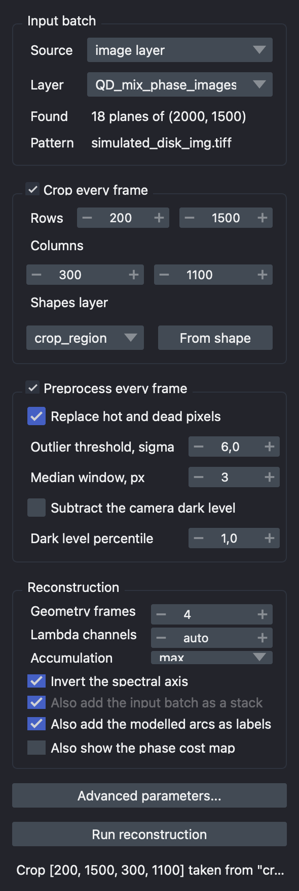

### Input batch

| Parameter | Default | Description |
|---|---|---|
| `Source` | folder of phase images | Where the frames come from: a folder on disk, or a 3D image layer already open in the viewer. |
| `Folder` | - | Folder of phase images. Files are sorted by name, which **must** be the acquisition order: the phase trajectory is constrained to advance in one direction over it. |
| `File mask` | `*.tif*` | Glob applied inside the folder. |
| `Layer` | - | 3D image layer whose planes are the phase images, in acquisition order. Shown instead of the folder rows when the source is a layer. |
| `Found` | - | How many images the current source holds. |
| `Pattern` | `simulated_disk_img.tiff` | The simulated disk pattern bundled with the plugin. It is not asked for: it belongs to the instrument, not to a batch. On first use it is rotated by 180 degrees to match the camera orientation, and skeletonised to the one-pixel-wide lines the line family model is fitted to. |

### Crop every frame

Optional `[row_min, row_max, col_min, col_max]` slice applied to every frame
as it is read. Off by default, and its rows are hidden while it is off.

The bounds can be typed, or taken from a rectangle drawn in the viewer:
select a shapes layer and press **From shape**. Only a rectangle aligned with
the frame axes is accepted - a crop is a plain array slice, and a rotated or
free-form outline would have to be silently replaced by its bounding box. The
vertices are read through the scale and the offset of their layer, so a
rectangle drawn over a layer that carries a scale of its own still lands on
the right frame pixels. With several shapes in the layer the first one is
used.

### Preprocess every frame

Optional cleaning, applied to every frame right after it is read and cropped.
It therefore reaches every stage of the run - the geometry search, the phase
profiles, the band sampling - and the input batch layer alike, so what the
layer shows is what the reconstruction worked on. Off by default, and its
rows are hidden while it is off.

| Parameter | Default | Description |
|---|---|---|
| `Replace hot and dead pixels` | on | Remove the camera's salt and pepper. See below. |
| `Outlier threshold, sigma` | 6.0 | How far outside its neighbourhood a pixel has to lie before it is replaced, in robust standard deviations. |
| `Median window, px` | 3 | Window side. 3 catches single pixels; 5 also catches pairs and clusters up to 3 x 3, because a pair defeats a 3 x 3 ring - each of the two sits in the other's neighbourhood. |
| `Subtract the camera dark level` | off | Subtract a constant pedestal, estimated from the frame itself. |
| `Dark level percentile` | 1.0 | The percentile taken as that level. It has to sit below any real signal. |

**Hot and dead pixels** matter here more than in most pipelines, because
every stage of this reconstruction works on extremes: the fold contrast that
selects the geometry, and the `max` accumulation that keeps the brightest
contribution of every band. One hot pixel poisons a whole band row.

They are removed **without touching the resolution**. A median filter would
not manage that - a median rounds off every feature one pixel wide, and here
those are the dark pattern lines themselves. `despeckle()` compares each
pixel with the *ring* of its neighbours, the window with its centre left out,
and replaces only the pixels that lie outside that whole ring. Anything that
continues into its neighbourhood - a line, an edge, a real bright spot - is
never outside its own ring and is never touched. On a test frame with
one-pixel-wide lines a 3 x 3 median changes 6057 pixels to remove 480 planted
ones and flattens the lines from 60 to 566 counts; the ring filter changes
the planted pixels and **not one other**, and leaves the lines at 60.

On the reference batch, at 6 sigma with a 5 x 5 window, it replaces 74 pixels
of 3 million - 0.0025 % - with corrections up to 5700 counts. The geometry
comes out the same to five decimal places, so the cleaning costs nothing in
accuracy; it costs about 0.2 s per frame read, roughly +50 % on the run time
of the sample batch.

**The dark level** is a constant the camera adds so that read noise cannot
clip at zero. It carries no signal and it costs fold contrast, because the
geometry search maximises `(peak - trough) / mean` and an offset inflates the
mean without touching the numerator. On the bundled sample the pedestal is
already removed and the first percentile is 0, so the option changes nothing
there; it is for raw data off other instruments.

### Reconstruction

| Parameter | Default | Description |
|---|---|---|
| `Geometry frames` | 4 | Number of evenly spaced frames used to estimate the shared geometry. |
| `Lambda channels` | auto | Resampled spectral channels per band. `auto` uses the rounded median line spacing, which resamples a band without losing resolution. |
| `Accumulation` | max | How frames writing to the same image row are combined: `max`, `mean` or `overwrite`. |
| `Invert the spectral axis` | off | Reverse the channel order of the assembled stack. A lambda stack is expected to run from short to long wavelengths, and which way the dispersion runs is a property of the instrument rather than of the data, so on a setup that sweeps the other way this turns the result around. Only the layer is reversed: the `PhaseModelRecon` instance behind it still answers in the order it sampled, so its own diagnostics stay consistent. |
| `Also add the input batch as a stack` | on | Add the frames as they were read, crop included, as an image layer. Disabled when the source already is a layer. |
| `Also add the modelled arcs as labels` | on | Add the arcs of every frame as a labels layer. |
| `Also show the phase cost map` | off | Open the reference diagnostic of the run in a window of its own once the layers are in. See below. |

### Advanced parameters

The rest of the `PhaseModelRecon` signature, in a window of its own so that
sixteen rows that are set once do not make the dock taller than the screen.

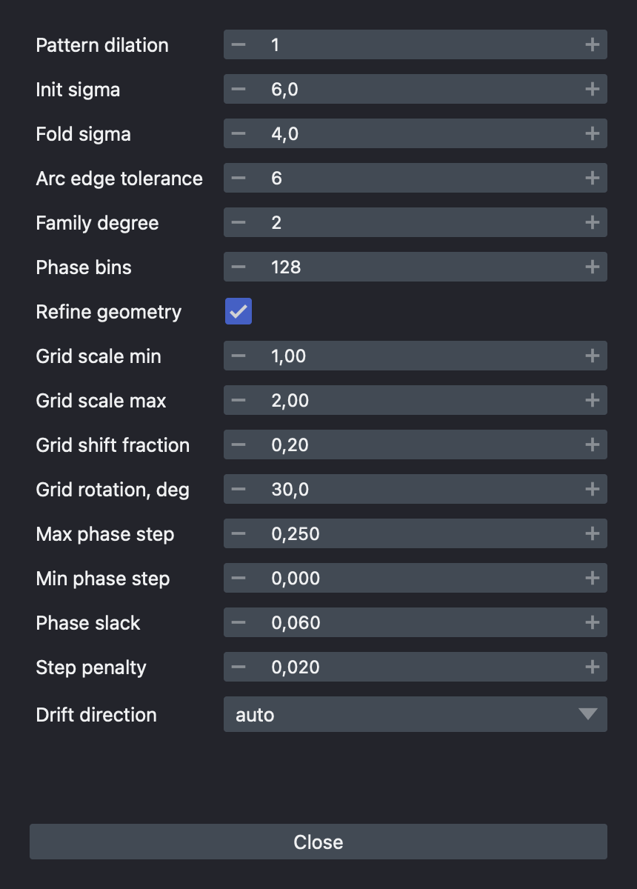

| Group | Parameters |
|---|---|
| Pattern and smoothing | `Pattern dilation`, `Init sigma`, `Fold sigma` |
| Line family model | `Arc edge tolerance`, `Family degree`, `Phase bins` |
| Geometry search | `Refine geometry`, `Grid scale min`/`max`, `Grid shift fraction`, `Grid rotation` |
| Phase trajectory | `Max phase step`, `Min phase step`, `Phase slack`, `Step penalty`, `Drift direction` |

### Output layers

| Layer | Type | Shape | Content |
|---|---|---|---|
| `<batch>_lambda_stack` | image, uint16 | `(n_lambda, height, width)` | the hyperspectral cube |
| `<batch>_input_batch` | image, float32 | `(n_image, height, width)` | the frames as the reconstruction read them |
| `<batch>_arcs` | labels, uint16 | `(n_image, height, width)` | the modelled arcs, one label per arc |

Every arc keeps its own label value and that value means the same
physical arc in every frame - step through the frames and one label is one arc
moving.

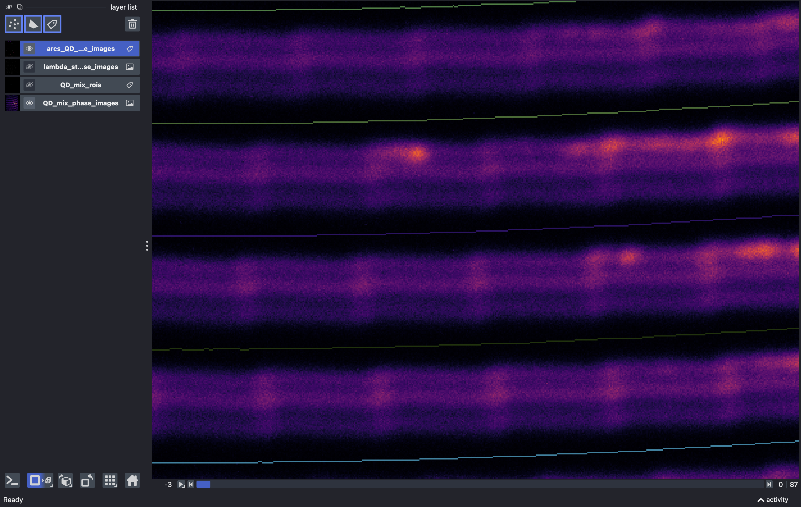

### Phase cost map

`Also show the phase cost map` opens the reference diagnostic of
`PhaseModelRecon` once the reconstruction is done. It is the one question a
reconstruction cannot answer about itself: whether the phases it settled on sit
on the cost ridge, or whether the batch drifted off it.

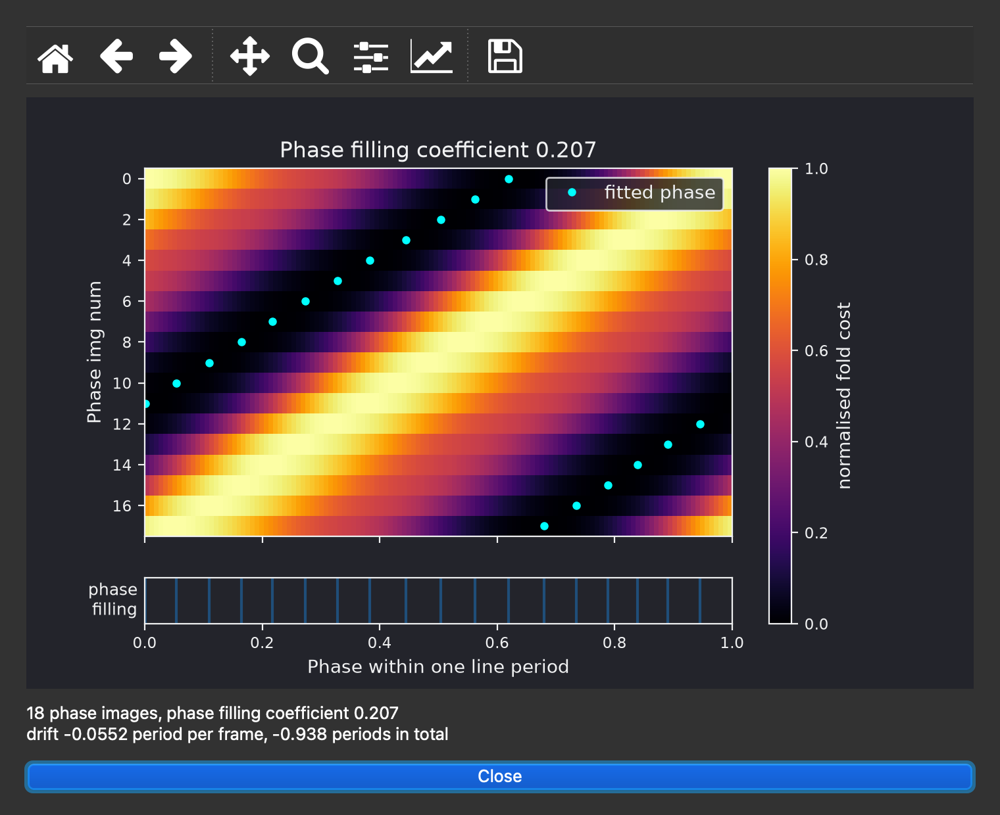

Each row of the image is one frame's folded phase cost, dark where the pattern
lines sit. A healthy batch shows **one** dark ridge with every cyan marker on
it; the slope of the ridge is the drift, and its extent along the phase axis is
the total drift in periods. Markers off the ridge mean the trajectory
constraints are too tight for the data - `Phase slack` and `Step penalty` in
the advanced parameters are what to loosen.

The strip underneath carries one stripe per phase image, and the fraction of it
that is inked is the **phase filling coefficient**: how much of the line period
the batch actually sampled. Gaps there are parts of every band that no frame
visited, and they cap how densely the lambda stack can ever be filled. The
report line under the plot repeats it next to the drift per frame.

## Stack post-processing

| | |
|---|---|
| 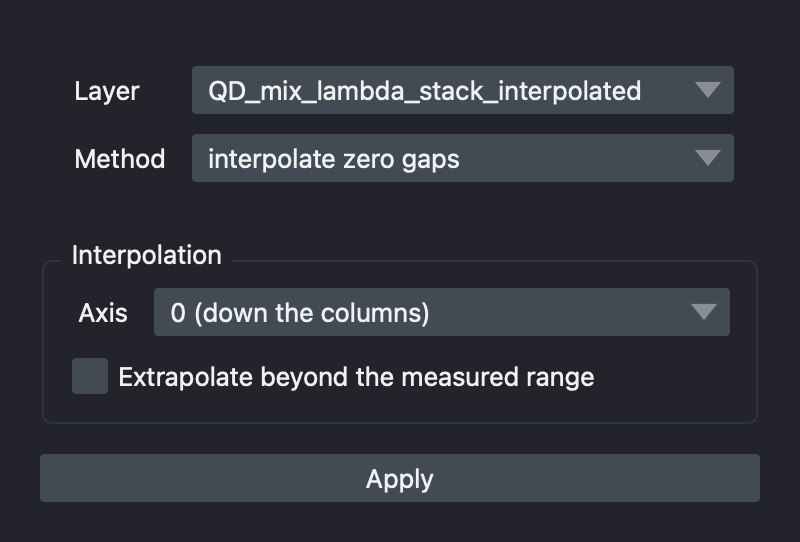 | 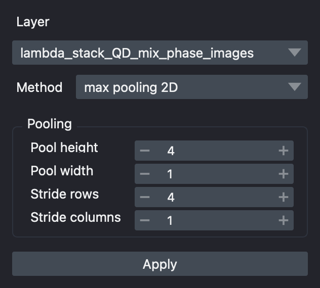 |

**interpolate zero gaps** - `interpolate_zero_gaps()`. Fills the empty rows by linear interpolation along one axis, treating zero pixels as missing data.

| Parameter | Default | Description |
|---|---|---|
| `Axis` | 0 | Interpolation axis. The gaps are horizontal stripes, so interpolating down the columns is what closes them. |
| `Extrapolate` | off | Whether to extend the first and last measured value of a column into the gaps beyond them. Off keeps the reconstruction honest about where it has no data at all. |

**max pooling 2D** - `max_pooling2d()`. Trades resolution for coverage: every output pixel is the brightest input pixel of its window, so a window that spans a filled row always lands on real data.

| Parameter | Default | Description |
|---|---|---|
| `Pool height`, `Pool width` | 4, 1 | Window. A tall narrow window is the useful shape, because the gaps are horizontal stripes: height buys coverage, width only throws away column resolution that was never missing. |
| `Stride rows`, `Stride columns` | 4, 1 | Step between windows. Equal to the window gives non-overlapping windows. |

The pooled layer is added with a `scale` equal to the stride, so it stays aligned with its source in the viewer. Pooling is a display and screening tool: because it keeps peaks and discards everything else, it is biased upwards and is not a step to run before quantitative spectroscopy.

## ROI spectra and calibration

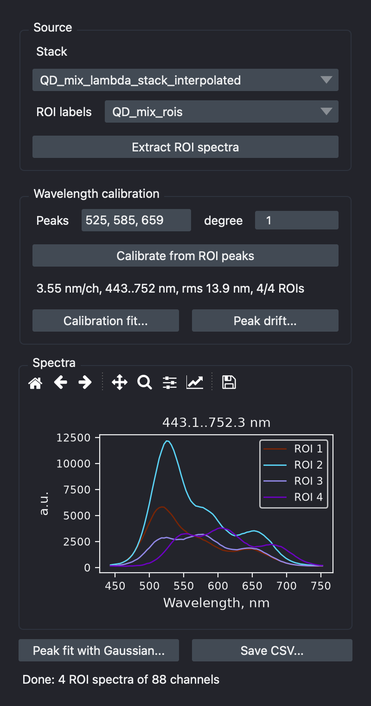

### 1. Source

| Parameter | Description |
|---|---|
| `Lambda stack` | The 3D image layer to measure. |
| `ROI labels` | A labels layer holding the regions - 2D or 3D label layer, painted with the napari brush, loaded as a mask, or the bundled sample. |

A 3D labels layer - what napari creates over a lambda stack, one plane per spectral channel - is flattened onto one plane before anything is measured, and the flattened mask is added as `<batch>_<name>_2D` with the geometry of the layer it came from. It is the mask the numbers actually came from.

### 2. Wavelength calibration

| Parameter | Default | Description |
|---|---|---|
| `Reference peaks, nm` | 525, 585, 659 | Known emission peaks of the sample, comma separated. |
| `Polynomial degree` | 1 | Degree of the fit from channel index to wavelength (1 is the linear fit). |

*Calibrate from ROI peaks* fits the peaks of every ROI spectrum and feeds the fitted centres of all of them at once to `spectral_calibration()`. The result line reports the dispersion in **nm per channel**, the calibrated range and the fit residual.

Only the ROIs whose fit returns exactly as many components as there are reference wavelengths enter the calibration - with a different number there is no way to say which fitted peak belongs to which emitter - and the widget says how many were used.

Two buttons open the plots that belong to this step. Each lives in a window of its own and is built the first time it is asked for, so neither takes room in the dock.

**Calibration fit...** - the fit the wavelength axis rests on, available once a calibration has run. Every point is one reference emitter, placed at the channel where it was actually found in a ROI spectrum against the wavelength it is known to emit at, in the colour of its region; the line is the fitted polynomial.

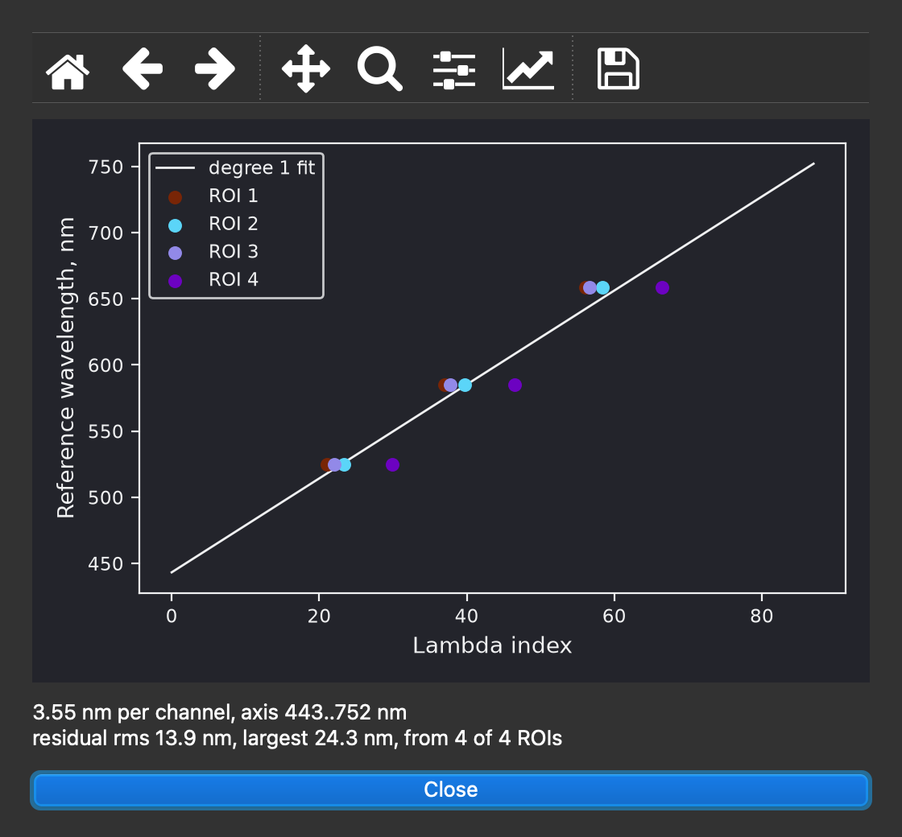

**Peak drift...** - the frame is cut into square tiles, the emitters of each tile are **unmixed** with Gaussian fit of individual reference peaks (`utils.peak_drift_unmixed()`), and the position of every component is drawn along both axes of the frame.

> [!IMPORTANT]
>
> Unmixing rather than peak-finding is the point. Following the highest point of a spectrum measures where the *mixture* peaks, not where any emitter sits, so a specimen whose species are deposited unevenly reads as a drift of its own. This approach works on quantum dots calibration samples only, because of near Gaussian-shape of the QD emission spectra.

| Parameter | Default | Description |
|---|---|---|
| `Tile size, px` | 64 | Side of the square binning tile. Larger tiles fit more reliably and resolve the drift more coarsely; the drift is a smooth gradient, so coarse is cheap. Slopes agree to three decimals between 48, 64 and 96 px. |
| `Min SNR` | 4.0 | Noise sigmas a tile spectrum must clear before it is fitted at all. |

**All components are drawn together, because the comparison between them is what settles the question.**

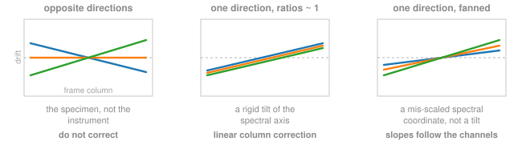

On the bundled sample batch the report reads `+6.99, +7.75, +8.34` channels per 1000 columns over 713 tiles - ratios `1.00, 1.11, 1.19` against the `1.00, 1.65, 2.43` a mis-scaled axis would give, so the middle case: a rigid tilt. Ratios are always taken in channels, where that prediction is defined, whatever unit the plot is drawn in.,

The row panel is not flat, though: its slopes grow with the channel index - `-0.07, -0.94, -1.93` per 1000 rows - the proportional signature rather than the rigid one. The linear column correction takes the larger rigid part and leaves that alone.

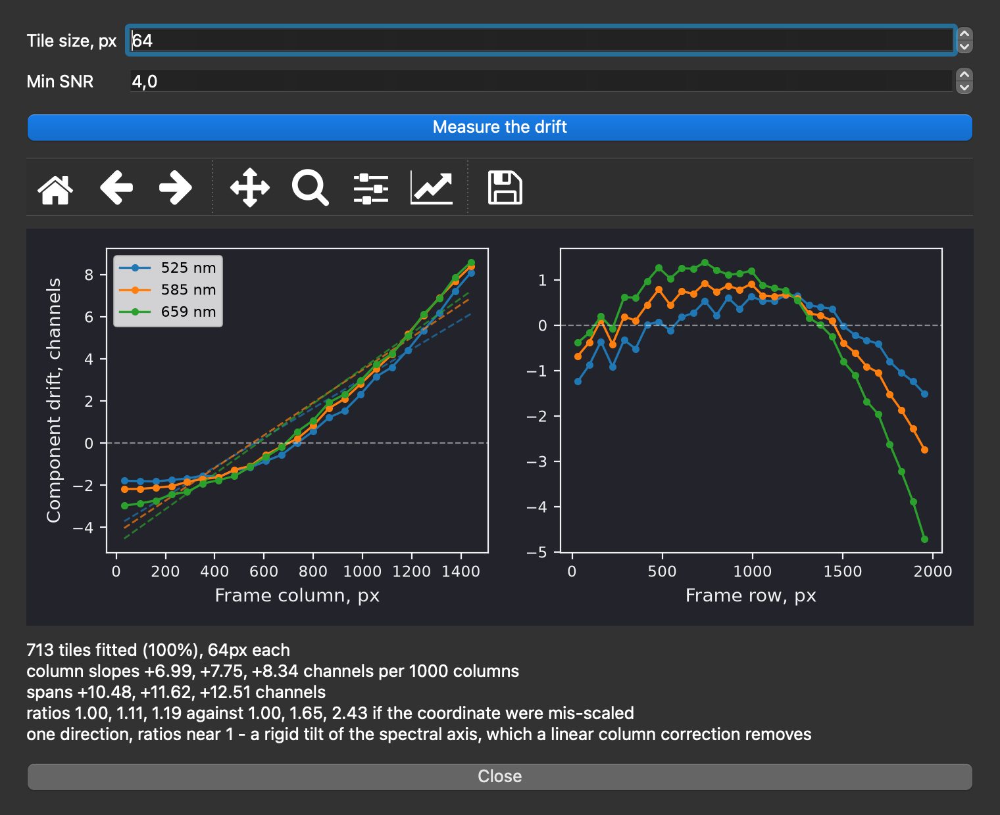

### 3. Spectra

The plot, in channels until the axis is calibrated and in nanometres afterwards - then titled with the calibrated range, first to last channel, e.g. `433.6..752.0 nm` - with the matplotlib toolbar for zooming and for saving the figure. Every curve carries the colour napari gives its ROI.

**Peak fit with Gaussian** - the decomposition of one region into emitters, in a window of its own: the data as points, the sum of the fit, and every component drawn separately in a shade of the region's colour, labelled with its centre.

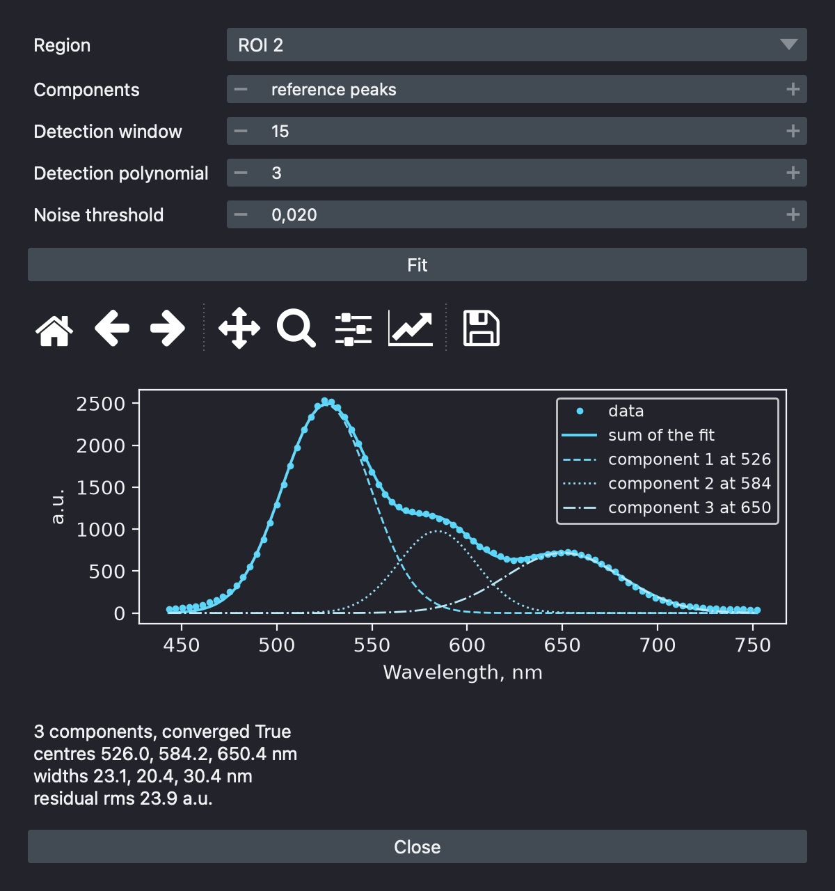

| Parameter | Default | Description |
|---|---|---|
| `Region` | first | Which extracted region to fit. |
| `Components` | reference peaks | Number of Gaussians. Setting it to the number of emitters actually in the sample is the single most effective thing you can do for the stability of the fit. |
| `Detection window` | 15 | Savitzky-Golay window in channels: the smallest structure that survives the peak detection. |
| `Detection polynomial` | 3 | Polynomial order of that filter. |
| `Noise threshold` | 0.02 | A candidate below this fraction of the maximum is rejected as baseline. |

### 4. Save spectra to CSV

One row per spectral channel:

| Column | Format | Present |
|---|---|---|
| `lambda_index` | integer | always |
| `wavelength_nm` | one decimal | when the axis is calibrated |
| `roi_<label>` | full precision | one per region |

```
lambda_index,wavelength_nm,roi_1,roi_2,roi_3,roi_4
0,443.3,42.7738,49.9025,34.9604,31.3488
1,446.8,51.0518,57.8027,35.8919,28.3496
```


## Lambda stack to RGB

Renders a spectral stack as the colour an eye would see: every pixel's
spectrum becomes one sRGB colour, at the brightness it actually has.

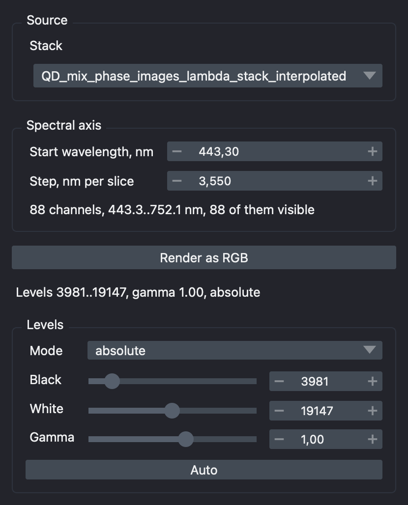

The widget is **independent of the rest of the plugin**. It takes any 3D image
layer whose first axis is spectral - a reconstruction, or a stack loaded from
a file - and needs no calibration from the ROI widget: the spectral axis is
described by two numbers typed in.

**Use an interpolated stack.** A raw reconstruction is sparse, and its empty
rows come out black; run *interpolate zero gaps* in
[Stack post-processing](#stack-post-processing) first.

### Parameters

| Parameter | Default | Description |
|---|---|---|
| `Stack` | - | Any 3D image layer, `(n_lambda, height, width)`. |
| `Start wavelength, nm` | 443.3 | Wavelength of channel 0. |
| `Step, nm per slice` | 3.55 | Wavelength step between channels. Negative for a stack that runs from long to short wavelengths. |

*Render as RGB* runs the spectral conversion once, in the background, and
keeps its linear colour. Everything in the **Levels** group below then acts on
that kept colour and the output layer follows the boxes as they are edited,
in about 0.1 s and without a new render - as the contrast limits of a grey
image do. Every render starts from the automatic levels.

Each level is a **slider with a box beside it**: drag for a rough setting,
type for an exact one; the two always show the same value. The Black and
White sliders span the whole brightness range of the render, 0 to its
brightest pixel, as napari's contrast-limit slider spans the data range; the
boxes accept values beyond it, and the slider then rests at its end. The
Gamma slider runs on a logarithmic scale over 0.1..5, so that 0.5 and 2 lie
the same distance either side of 1.

| Level | Default | Description |
|---|---|---|
| `Mode` | absolute | How brightness is set, see below. |
| `Black` | auto | Brightness rendered black. |
| `White` | auto | Brightness rendered at full white; *absolute* only. |
| `Gamma` | 1.0 | Exponent between the two levels: 1 keeps relative brightness, below 1 lifts faint regions, above 1 presses them down; *absolute* only. |
| `Auto` | - | Black at the median brightness, white at its 99.5th percentile. |

**Brightness** is the brightest display channel of a pixel - the one that
meets the display limit first - and the levels are in the **units of the
stack**: the colour is normalised so that a flat spectrum of intensity `v` has
brightness `v`, which makes the levels comparable with the contrast limits of
the stack itself. The boxes take their step and their decimals from the scale
of the image.

The levels act on brightness, **not channel by channel**: all three channels
of a pixel are scaled by one factor, so the black level darkens a background
without changing the hue of what lies on it, and a highlight above the white
saturates in brightness, not in colour. The contrast limits napari offers on
an RGB layer subtract the same amount from every channel and would shift the
colour; leave them at 0..255.

The automatic black at the median suits sparse emitters on a broad
background, as in the sample: there the median pixel is background, and the
yellow-orange of the mixed background - a real, broad emission peaking near
560..580 nm, not an artefact - goes to black. A specimen that fills most of the
frame needs a lower black.

The defaults are the calibration of the bundled sample. The line under the two
axis fields reports the range they describe and how many channels fall inside
the visible 360..830 nm; channels outside it carry no weight, and an axis that
lies entirely outside it is refused rather than rendered black. For a stack
built with *Invert the spectral axis*, give the start and the step of the
order the channels actually have.

### Intensity modes

| Mode | Scale | Answers |
|---|---|---|
| `absolute` | brightness through black, white and gamma | what the specimen looks like - with black 0 and gamma 1 relative brightness between regions is kept exactly |
| `per-pixel` | every pixel above the black level at the full brightness its hue allows, the rest black | which colour each place is, however faint - brightness is discarded, the black level is a threshold that keeps noise from being blown up into colour |

Levels are set on the brightest channel of each pixel, not on its luminance:
a saturated colour drives one channel far above its luminance, and levels on
luminance would press every such pixel against the display limit and flatten
the brightness ratios. With black 0 a region at a fifth of the brightness of
another renders at exactly a fifth of its linear value.

### Colorimetry

The route is the standard one, in five steps:

1. **Spectral weighting.** Channel `k` sits at `start + k * step`, and the
   CIE 1931 2 degree colour matching functions are interpolated onto that
   axis. `XYZ = sum_k S_k * cmf(lambda_k) * step` - three matrix products over
   the spectral axis, done in row blocks so the cube is never converted to
   floating point whole. An 88 x 2000 x 1500 stack converts in 0.3 s; new
   levels take 0.07 s.
2. **White adaptation.** An emission spectrum has the equal-energy white;
   sRGB has D65. A Bradford transform adapts one to the other, so a flat
   spectrum renders as neutral grey - as it looks to an adapted eye.
3. **To sRGB.** `XYZ` is mapped to linear sRGB with the IEC 61966-2-1 matrix.
4. **Out of gamut.** Narrow emitters - quantum dots, lasers - are more
   saturated than any display can show and come out with negative
   components. They are desaturated towards white by the amount they fall
   short, which keeps the hue; clipping would shift it. On the sample 80 % of
   the lit pixels are outside the sRGB gamut, and the status line reports
   that fraction for every image.
5. **Levels and gamma.** The colour is divided by the summed luminance
   weight of the channels, so it is in stack units, and kept. Black, white
   and gamma scale each pixel as a whole, so a pixel above the white is not
   clipped channel by channel, which would turn an overexposed saturated blue
   magenta. The sRGB transfer curve is applied last.

The **2 degree observer is fixed**, not offered as a choice. sRGB itself is
defined on the CIE 1931 2 degree observer - its primaries and its white point
are given in those coordinates - so tristimulus values from the 10 degree
observer would need a display matrix of their own; mixing the two would give a
colour that belongs to neither. The two observers differ mainly in the
blue-violet, where the macular pigment over the fovea absorbs: the D65 white
point moves by 1.45 % in Z between them, against 0.25 % in X. Emitters at
525, 585 and 659 nm sit where the two sets nearly coincide.

The colour matching functions ship with the plugin as `cie1931_2deg.csv`,
1 nm steps over 360..830 nm, from the Colour & Vision Research Laboratory,
UCL (http://www.cvrl.org/).

### Output

| Layer | Type | Shape |
|---|---|---|
| `<batch>_rgb` | image, `rgb=True`, uint8 | `(height, width, 3)` |

The layer keeps the scale and offset of its source, so it overlays it. The
widget keeps the linear colour of the last render only, for the levels to act
on (36 MB for a 2000 x 1500 frame); it is released when the layer is deleted,
and the levels are disabled until the next render. An earlier RGB layer keeps
the levels it had.

Checked on spectra with a known answer: a flat spectrum renders neutral grey,
and narrow lines at 450, 525, 585 and 659 nm render blue-violet, green,
orange and red. On the sample, the four bundled regions come out in the order
their spectra peak - green for the two peaking at 518 and 525 nm,
yellow-green at 578 nm, amber at 603 nm.

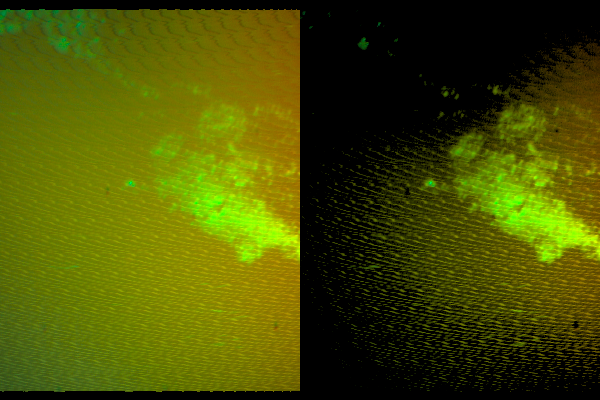

*The interpolated sample in absolute mode, black 0 (left) and with the
automatic levels (right): the black at the median takes away the
yellow-orange of the mixed background and leaves the green quantum dot
clusters on it, in the same hue.*
