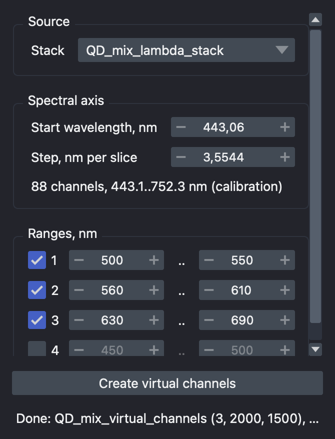

# spectra-spin-napari

[](https://stand-with-ukraine.pp.ua)

A [napari](https://napari.org) plugin for hyperspectral reconstruction of spinning-disk spectral microscopy data.

- Input: a series of monochrome phase images from a spinning-disk confocal with a dispersing prism.
- Output: a lambda stack `(lambda, H, W)`, ROI spectra calibrated to nm, true-colour and virtual-channel images.
- Processing code: the unmodified modules of [Spectra-Spin](https://github.com/wisstock/spectra-spin) (`phase_model_recon.py`, `utils.py`); `_widgets.py` holds the GUI.

# Installation

| Package | Version |
|---|---|
| Python | >= 3.11 |
| numpy | >= 2.0 |
| scipy | >= 1.13 |
| scikit-image | >= 0.24 |
| matplotlib | >= 3.9 |
| PySide6 | - |
| napari | >= 0.5, tested on 0.9 |
| numba | tested on 0.67; optional, without it the reconstruction runs single-threaded |

```bash
conda create -y -n napari-env -c conda-forge python=3.12
conda activate napari-env
conda install -c conda-forge napari pyside6 numba
git clone https://github.com/wisstock/spectra-spin-napari.git
cd spectra-spin-napari
python -m pip install .
```

# Sample data

**File > Open Sample > Spectra-Spin**

| Sample | Layer | Shape, dtype | Content |
|---|---|---|---|
| QD mix phase images | `QD_mix_phase_images`, image | `(18, 2000, 1500)`, uint16 | quantum dots emitting at 525, 585, 659 nm; already cropped - leave *Crop every frame* off |
| QD mix regions of interest | `QD_mix_rois`, labels | `(2000, 1500)`, uint32 | four regions on the reconstruction of that batch |

# Widgets

| Widget | Input | Output |
|---|---|---|
| [Phase model reconstruction](#phase-model-reconstruction) | folder of phase images or 3D image layer | lambda stack, input batch, modelled arcs |
| [Stack post-processing](#stack-post-processing) | image layer | gap-filled or max-pooled copy |
| [ROI spectra and calibration](#roi-spectra-and-calibration) | lambda stack + labels layer | spectra, wavelength calibration, 2D mask, CSV |
| [Lambda stack to RGB](#lambda-stack-to-rgb) | 3D stack, spectral first axis | true-colour sRGB image |
| [Stack to virtual channels](#stack-to-virtual-channels) | 3D stack, spectral first axis | 1..4 channels summed over wavelength ranges |

Common behaviour:
- Output layer names: `<batch>_<suffix>`, underscores only, e.g. `QD_mix_lambda_stack`, `QD_mix_lambda_stack_interpolated`, `QD_mix_rgb`, `QD_mix_virtual_channels`.
- A wavelength calibration from *ROI spectra and calibration* fills `Start wavelength` and `Step` of *Lambda stack to RGB* and *Stack to virtual channels*, see [Spectral axis](#spectral-axis).

## Phase model reconstruction

`PhaseModelRecon.run()` + `lambda_stack_recon()`.


**Input batch**

| Parameter | Default | Values | Description |
|---|---|---|---|
| `Source` | folder | folder, image layer | where the frames come from |
| `Folder` | - | path | files sorted by name = acquisition order; hidden files (`._*` companions on exFAT/FAT drives) skipped |
| `File mask` | `*.tif*` | glob | file filter inside the folder |
| `Layer` | - | 3D image layer | planes = phase images in acquisition order |

- Pattern: the bundled `simulated_disk_img.tiff`, not selectable.
- Folder source: the first phase image is loaded as `<batch>_first_phase`, with an empty shapes layer `<batch>_crop` in rectangle mode for drawing the crop.

**Crop every frame** (off)

| Parameter | Default | Values | Description |
|---|---|---|---|
| `Rows` | 1000, 2000 | 0..65535 | `row_min`, `row_max` |
| `Columns` | 1000, 2000 | 0..65535 | `col_min`, `col_max` |
| `Draw in` | `<batch>_crop` | shapes layer | its last rectangle fills `Rows`, `Columns` and turns the crop on while it is drawn or moved; axis-aligned rectangles only |

**Preprocess every frame** (off) - applied to every frame read, in every stage and in the input batch layer.

| Parameter | Default | Values | Description |
|---|---|---|---|
| `Replace hot and dead pixels` | on | on/off | `despeckle()`: replaces only pixels outside the range of their neighbour ring; lines and edges untouched |
| `Outlier threshold, sigma` | 6.0 | 1..50 | robust sigmas beyond the ring |
| `Median window, px` | 3 | 3, 5, 7, 9 | 3 - single pixels, 5 - clusters up to 3 x 3 |
| `Subtract the camera dark level` | off | on/off | `subtract_dark_level()`: constant pedestal, clipped at 0 |
| `Dark level percentile` | 1.0 | 0..50 | percentile taken as the pedestal |

**Reconstruction**

| Parameter | Default | Values | Description |
|---|---|---|---|
| `Geometry frames` | 4 | 1..64 | evenly spaced frames for the shared geometry |
| `Lambda channels` | auto | auto, 1..4096 | channels per band; auto = median line spacing |
| `Accumulation` | max | max, mean, overwrite | merge of frames writing the same row |
| `Invert the spectral axis` | off | on/off | reverse channel order of the output layer only |
| `Also add the input batch as a stack` | on | on/off | frames as read; folder source only |
| `Also add the modelled arcs as labels` | on | on/off | one label per physical arc, same value in every frame |
| `Also show the phase cost map` | off | on/off | diagnostic window after the run |

**Advanced parameters...** - the rest of the `PhaseModelRecon` signature, see its docstring.


| Group | Parameter | Default | Values |
|---|---|---|---|
| Pattern and smoothing | `Pattern dilation` | 1 | 0..20 |
| | `Init sigma` | 6.0 | 0..50 |
| | `Fold sigma` | 4.0 | 0..50 |
| Line family model | `Arc edge tolerance` | 6 | 0..100 |
| | `Family degree` | 2 | 1..5 |
| | `Phase bins` | 128 | 8..1024 |
| Geometry search | `Refine geometry` | on | on/off |
| | `Grid scale min`, `max` | 1.0, 2.0 | 0.1..10 |
| | `Grid shift fraction` | 0.2 | 0..1 |
| | `Grid rotation, deg` | 30 | 0..180 |
| Phase trajectory | `Max phase step` | 0.25 | 0..0.5 |
| | `Min phase step` | 0.0 | 0..0.5 |
| | `Phase slack` | 0.06 | 0..0.5 |
| | `Step penalty` | 0.02 | 0..10 |
| | `Drift direction` | auto | auto, +1, -1 |

**Output**

| Layer | Type | Shape |
|---|---|---|
| `<batch>_lambda_stack` | image, uint16 | `(n_lambda, H, W)` |
| `<batch>_input_batch` | image, float32 | `(n_image, H, W)` |
| `<batch>_arcs` | labels, uint16 | `(n_image, H, W)` |


**Phase cost map** - one row per frame, folded phase cost; dark ridge = pattern line.


| Reading | Meaning | Action |
|---|---|---|
| all markers on one ridge | trajectory found | - |
| markers off the ridge | constraints too tight | raise `Phase slack`, lower `Step penalty` |
| gaps in the bottom strip | phase filling < 1, parts of every band never sampled | more frames, or more drift between them |

**Multithreading**

- With numba installed the reconstruction always runs multithreaded on all cores; without it, single-threaded on scipy.
- A napari notification at the start of every run states the mode and the number of threads.
- Kernels (`numba_kernels()`): template cost, phase fold, band sampling; compiled on the first run, cached on disk.
- Same algorithm as `PhaseModelRecon`; results are independent of the thread count but not bit-identical to the scipy path (summation order; the geometry refinement amplifies it).

| Path | `run()` on the sample, 12 cores |
|---|---|
| scipy | 30 s |
| numba | 4 s |

## Stack post-processing

| | |
|---|---|
|  |  |

**interpolate zero gaps** - `interpolate_zero_gaps()`, zero pixels treated as missing.

| Parameter | Default | Values | Description |
|---|---|---|---|
| `Axis` | 0 | 0 (down the columns), 1 (along the rows) | 0 closes the horizontal gap stripes |
| `Extrapolate beyond the measured range` | off | on/off | extend edge values into outer gaps |

**max pooling 2D** - `max_pooling2d()`, display and screening only (biased upwards).

| Parameter | Default | Values | Description |
|---|---|---|---|
| `Pool height`, `Pool width` | 4, 1 | 1..128 | window |
| `Stride rows`, `Stride columns` | 4, 1 | 1..128 | step; output layer `scale` = stride |

- Output: `<layer>_interpolated` or `<layer>_pooled`.

## ROI spectra and calibration


**1. Source**

| Parameter | Values | Description |
|---|---|---|
| `Stack` | 3D image layer | stack to measure |
| `ROI labels` | 2D or 3D labels layer | regions; a 3D layer is flattened and added as `<batch>_<name>_2D` |

**2. Wavelength calibration** - Gaussian peak fit of every ROI spectrum + `spectral_calibration()`.

| Parameter | Default | Values | Description |
|---|---|---|---|
| `Peaks` | 525, 585, 659 | comma-separated nm | known emission peaks |
| `degree` | 1 | 1..3 | polynomial degree, channel index -> wavelength |

- Only ROIs with exactly one fitted component per reference peak enter the fit.
- Result line: nm per channel, axis range, residual rms, ROIs used; its tooltip gives full precision and the excluded ROIs.
- After every calibration: `Start wavelength` = wavelength of channel 0, `Step` = (last - first) / (n - 1), put into the [Spectral axis](#spectral-axis) fields of the other widgets. A calibration running from long to short wavelengths is not passed on: reconstruct with `Invert the spectral axis`.
- **Calibration fit...** - reference peaks vs channel with the fitted polynomial; excluded ROIs listed in the legend (hollow marker) and in the report with the number of peaks found.


**Peak drift...** - tiles of the frame, emitters unmixed by Gaussian fit (`utils.peak_drift_unmixed()`), component positions along both frame axes.

> [!IMPORTANT]
> Valid for quantum dot calibration samples only (near-Gaussian emission). Unmixing, not peak-finding: the maximum of a mixture moves with the mixing ratio.

| Parameter | Default | Values | Description |
|---|---|---|---|
| `Tile size, px` | 64 | 8..512 | side of the square tile |
| `Min SNR` | 4.0 | 0..100 | noise sigmas a tile spectrum must clear |

| Slopes of the components (channels per 1000 px) | Diagnosis |
|---|---|
| equal | rigid tilt of the spectral axis |
| proportional to the channel index | mis-scaled axis |


**3. Spectra** - plot in channels, in nm after calibration (title: calibrated range); curve colour = ROI label colour; takes the free height of the dock.

**Peak fit with Gaussian** - one region decomposed into components.


| Parameter | Default | Values | Description |
|---|---|---|---|
| `Region` | first | extracted ROIs | region to fit |
| `Components` | reference peaks | reference peaks, 1..20 | number of Gaussians |
| `Detection window` | 15 | 5..201, odd | Savitzky-Golay window, channels |
| `Detection polynomial` | 3 | 1..7 | Savitzky-Golay order |
| `Noise threshold` | 0.02 | 0..1 | rejected below this fraction of the maximum |

**4. Save CSV...** - one row per channel.

| Column | Format | Present |
|---|---|---|
| `lambda_index` | integer | always |
| `wavelength_nm` | one decimal | calibrated axis |
| `roi_<label>` | full precision | one per region |

```
lambda_index,wavelength_nm,roi_1,roi_2,roi_3,roi_4
0,443.3,42.7738,49.9025,34.9604,31.3488
```

## Spectral axis

Shared group of *Lambda stack to RGB* and *Stack to virtual channels*.

| Parameter | Default | Values | Description |
|---|---|---|---|
| `Start wavelength, nm` | 443.3 | 100..2000 | wavelength of channel 0 |
| `Step, nm per slice` | 3.55 | 0.0001..100 | channels run from short to long wavelengths |

| Source of the values | When |
|---|---|
| calibration | every calibration in *ROI spectra and calibration*, also into open widgets |
| manual | typed values; kept until the next calibration |
| default | calibration of the bundled sample |

- The line under the fields: channels, range in nm, source of the values (`calibration`, `manual`, `default`).

## Lambda stack to RGB

Spectrum of every pixel -> CIE 1931 2° XYZ -> sRGB. Use an interpolated stack: empty rows render black.


**Render as RGB** converts once; the **Levels** then act live on the kept colour.

| Level | Default | Values | Description |
|---|---|---|---|
| `Mode` | absolute | absolute, per-pixel | see below |
| `Black` | auto | 0..max brightness (slider), any (box) | brightness rendered black |
| `White` | auto | as `Black` | brightness rendered white; absolute only |
| `Gamma` | 1.0 | 0.1..5, log slider | 1 = linear; < 1 lifts faint regions; absolute only |
| `Auto` | - | - | black = median brightness, white = 99.5th percentile |

| Mode | Brightness | Use |
|---|---|---|
| absolute | black -> white -> gamma | appearance; with black 0, gamma 1 relative brightness is exact |
| per-pixel | full for every pixel above `Black`, 0 below | colour only |

- Brightness = brightest display channel of a pixel, in stack units (flat spectrum of intensity `v` -> `v`).
- Levels scale the three channels of a pixel together: hue is kept. napari's own contrast limits on the RGB layer act per channel and shift the hue - keep them at 0..255.
- The automatic black (median) suits sparse emitters on a background; lower it for a specimen filling the frame.

| Colorimetry step | Method |
|---|---|
| spectral weighting | CIE 1931 2° CMF (`cie1931_2deg.csv`, CVRL, 360..830 nm, 1 nm) interpolated onto the axis; channels outside 360..830 nm carry no weight |
| white | equal-energy -> D65, Bradford |
| to sRGB | IEC 61966-2-1 matrix |
| out of gamut | desaturated towards white at constant hue |
| highlights | pixel scaled as a whole, no per-channel clipping |
| transfer curve | sRGB gamma |

- 2° observer fixed: sRGB is defined on it.

| Output | Type | Shape |
|---|---|---|
| `<batch>_rgb` | image, rgb, uint8 | `(H, W, 3)` |


*Absolute mode, black 0 (left) and automatic levels (right).*

## Stack to virtual channels

`virtual_channels()`: channel `k` = per-pixel sum of the input channels whose wavelength lies in range `k`, bounds included.



| Parameter | Default | Values | Description |
|---|---|---|---|
| `Stack` | - | 3D image layer | spectral first axis |
| `Start wavelength, nm`, `Step, nm per slice` | calibration | see [Spectral axis](#spectral-axis) | |
| Range 1..4 | 500..550, 560..610, 630..690 on; 450..500 off | 100..2000 nm, 1..4 enabled | pass bands; every enabled range must hold a channel |

| Output | Type | Shape |
|---|---|---|
| `<batch>_virtual_channels` | image, float32 | `(n_ranges, H, W)` |

- Sums are exact for integer stacks up to 2^24 per pixel.
- XY scale and offset of the source are kept.
