# spectra-spin-napari

[](https://stand-with-ukraine.pp.ua)

A [napari](https://napari.org) plugin for hyperspectral reconstruction of spinning-disk spectral microscopy data.

- Input: a series of monochrome phase images from a spinning-disk confocal with a dispersing prism.
- Output: a lambda stack `(lambda, H, W)`, ROI spectra calibrated to nm, true-colour and virtual-channel images, blindly separated dyes.
- Processing code: the modules of [Spectra-Spin](https://github.com/wisstock/spectra-spin) (`phase_model_recon.py` with the line width added, `utils.py` unmodified); `_widgets.py` holds the GUI.

# Installation

| Package | Version |
|---|---|
| Python | >= 3.11 |
| numpy | >= 2.0 |
| scipy | >= 1.13 |
| scikit-image | >= 0.24 |
| matplotlib | >= 3.9 |
| PySide6 | - |
| napari | >= 0.5, tested on 0.9 |
| numba | tested on 0.67; optional, without it the reconstruction runs single-threaded |
| PyYAML | - |

```bash
conda create -y -n napari-env -c conda-forge python=3.12
conda activate napari-env
conda install -c conda-forge napari pyside6 numba
git clone https://github.com/wisstock/spectra-spin-napari.git
cd spectra-spin-napari
python -m pip install .
```

- `python -m pip install -e .` instead keeps `setup_params.yaml` editable in the source tree.

# Setup parameters

`src/spectra_spin_napari/setup_params.yaml` - measured characteristics of one microscope (disk, optics), used as defaults. Read by the widgets once per session to fill their fields; every field stays editable. `PhaseModelRecon` never reads it. How to measure each value: [Setup calibration](#setup-calibration).

| Key | Default | Unit | Widget field |
|---|---|---|---|
| `disk.pattern_file` | `simulated_disk_img.tiff` | path, relative to the file | pattern of the reconstruction |
| `disk.pattern_rotate_180` | true | - | pattern orientation against the camera |
| `disk.pass_width` | 0.0533 | line period | `Pass width, period` |
| `disk.pass_pulse_us` | 80 | µs | pulse of one pass, shown next to `Pattern passes` |
| `disk.drift_direction` | auto | auto, +1, -1 | `Drift direction` |
| `optics.invert_spectral_axis` | false | - | `Invert the spectral axis` |
| `optics.n_lambda` | 89 | channels per band, or auto | `Lambda channels`; line period in rows for `Line width` |
| `optics.spectral_fwhm` | 11.0 | channels of `optics.n_lambda`, 1 pass | `Spectral resolution` |

- Not in the file: the wavelength axis in nm and the reference peaks (they depend on the sample, see [Spectral calibration](#spectral-calibration)), the phase trajectory limits (acquisition protocol), algorithm settings (fixed defaults in the widgets; `Init sigma`, `Fold sigma`, `Arc edge tolerance` scale with `optics.n_lambda`, see [Advanced parameters](#phase-model-reconstruction)).
- A missing key stops the widget with the name of the key.

# Sample data

**File > Open Sample > Spectra-Spin**

| Sample | Layer | Shape, dtype | Content |
|---|---|---|---|
| QD mix phase images | `QD_mix_phase_images`, image | `(18, 2000, 1500)`, uint16 | quantum dots emitting at 525, 585, 659 nm; already cropped - leave *Crop every frame* off |
| QD mix regions of interest | `QD_mix_rois`, labels | `(2000, 1500)`, uint32 | four regions on the reconstruction of that batch |

# Widgets

| Widget | Input | Output |
|---|---|---|
| [Phase model reconstruction](#phase-model-reconstruction) | folder of phase images or 3D image layer | lambda stack, input batch, modelled arcs |
| [Stack post-processing](#stack-post-processing) | image layer | gap-filled or max-pooled copy |
| [ROI spectra and calibration](#roi-spectra-and-calibration) | lambda stack + labels layer | spectra, wavelength calibration, 2D mask, CSV |
| [Lambda stack to RGB](#lambda-stack-to-rgb) | 3D stack, spectral first axis | true-colour sRGB image |
| [Stack to virtual channels](#stack-to-virtual-channels) | 3D stack, spectral first axis | 1..4 channels summed over wavelength ranges |
| [Adaptive dye separation](#adaptive-dye-separation) | 3D stack, spectral first axis | one channel per dye, cluster map, dye spectra |

Common behaviour:
- Output layer names: `<batch>_<suffix>`, underscores only, e.g. `QD_mix_lambda_stack`, `QD_mix_lambda_stack_interpolated`, `QD_mix_rgb`, `QD_mix_virtual_channels`, `QD_mix_ads`.
- A wavelength calibration from *ROI spectra and calibration* fills `Start wavelength` and `Step` of *Lambda stack to RGB*, *Stack to virtual channels* and *Adaptive dye separation*, see [Spectral axis](#spectral-axis).

## Phase model reconstruction

`PhaseModelRecon.run()` + `lambda_stack_recon()`.

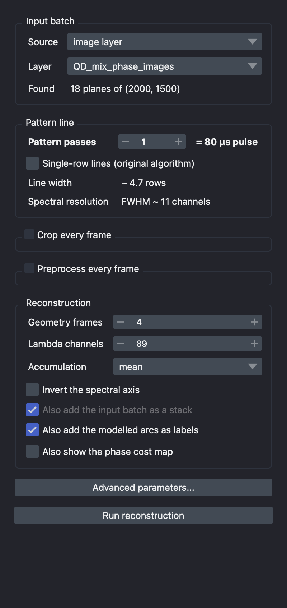

**Input batch**

| Parameter | Default | Values | Description |
|---|---|---|---|
| `Source` | folder | folder, image layer | where the frames come from |
| `Folder` | - | path | files sorted by name = acquisition order; hidden files (`._*` companions on exFAT/FAT drives) skipped |
| `File mask` | `*.tif*` | glob | file filter inside the folder |
| `Layer` | - | 3D image layer | planes = phase images in acquisition order |

- Pattern: `disk.pattern_file` of [setup_params.yaml](#setup-parameters), not selectable in the widget.
- Folder source: the first phase image is loaded as `<batch>_first_phase`, with an empty shapes layer `<batch>_crop` in rectangle mode for drawing the crop.

**Pattern line** - the passes of the acquisition; no fit finds them in the frames.

| Parameter | Default | Values | Description |
|---|---|---|---|
| `Pattern passes` | 1 | 1..6 | passes of the pattern per exposure, one per `disk.pass_pulse_us` of pulse (shown next to the box): 1 = 80 µs, 2 = 160 µs, 4 = 320 µs; every band is written into the rows its line swept |
| `Single-row lines (original algorithm)` | off | on/off | every band into one 1-px row (`line_passes=None`); `Pattern passes` then only sets `Spectral resolution` |
| `Line width` | - | read-only | rows a band is written into: passes × `Pass width` × `optics.n_lambda` |
| `Spectral resolution` | - | read-only | expected FWHM of a narrow line, channels: `optics.spectral_fwhm` widened by the sweep of the line; the channels sample it several times over |

**Crop every frame** (off)

| Parameter | Default | Values | Description |
|---|---|---|---|
| `Rows` | 1000, 2000 | 0..65535 | `row_min`, `row_max` |
| `Columns` | 1000, 2000 | 0..65535 | `col_min`, `col_max` |
| `Draw in` | `<batch>_crop` | shapes layer | its last rectangle fills `Rows`, `Columns` and turns the crop on while it is drawn or moved; axis-aligned rectangles only |

**Preprocess every frame** (off) - applied to every frame read, in every stage and in the input batch layer.

| Parameter | Default | Values | Description |
|---|---|---|---|
| `Replace hot and dead pixels` | on | on/off | `despeckle()`: replaces only pixels outside the range of their neighbour ring; lines and edges untouched |
| `Outlier threshold, sigma` | 6.0 | 1..50 | robust sigmas beyond the ring |
| `Median window, px` | 3 | 3, 5, 7, 9 | 3 - single pixels, 5 - clusters up to 3 x 3 |
| `Subtract the camera dark level` | off | on/off | `subtract_dark_level()`: constant pedestal, clipped at 0 |
| `Dark level percentile` | 1.0 | 0..50 | percentile taken as the pedestal |

**Reconstruction**

| Parameter | Default | Values | Description |
|---|---|---|---|
| `Geometry frames` | 4 | 1..64 | evenly spaced frames for the shared geometry |
| `Lambda channels` | 89 | auto, 1..4096 | channels per band, default `optics.n_lambda`; auto = median line spacing of the batch |
| `Accumulation` | max | max, mean, overwrite | merge of frames writing the same row |
| `Invert the spectral axis` | off | on/off | reverse channel order of the output layer only |
| `Also add the input batch as a stack` | on | on/off | frames as read; folder source only |
| `Also add the modelled arcs as labels` | on | on/off | one label per physical arc, same value in every frame |
| `Also show the phase cost map` | off | on/off | diagnostic window after the run |

**Advanced parameters...** - the rest of the `PhaseModelRecon` signature, see its docstring.

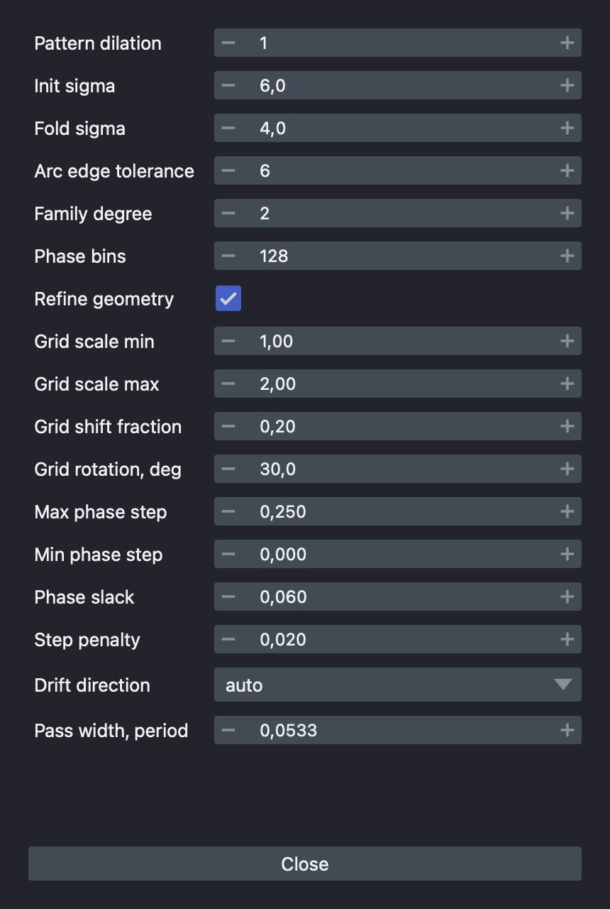

| Group | Parameter | Default | Values |
|---|---|---|---|
| Pattern and smoothing | `Pattern dilation` | 1 | 0..20 |
| | `Init sigma` | 6.0 × `optics.n_lambda` / 89 | 0..50 |
| | `Fold sigma` | 4.0 × `optics.n_lambda` / 89 | 0..50 |
| Line family model | `Arc edge tolerance` | 6 × `optics.n_lambda` / 89, rounded | 0..100 |
| | `Family degree` | 2 | 1..5 |
| | `Phase bins` | 128 | 8..1024 |
| Geometry search | `Refine geometry` | on | on/off |
| | `Grid scale min`, `max` | 1.0, 2.0 | 0.1..10 |
| | `Grid shift fraction` | 0.2 | 0..1 |
| | `Grid rotation, deg` | 30 | 0..180 |
| Phase trajectory | `Max phase step` | 0.25 | 0..0.5 |
| | `Min phase step` | 0.0 | 0..0.5 |
| | `Phase slack` | 0.06 | 0..0.5 |
| | `Step penalty` | 0.02 | 0..10 |
| | `Drift direction` | auto | auto, +1, -1 |
| Pattern line | `Pass width, period` | 0.0533 | 0.001..0.5 |

- `Init sigma`, `Fold sigma`, `Arc edge tolerance`: lengths on the frame, so their defaults follow the line period `optics.n_lambda` (6.0, 4.0, 6 at 89); `auto` keeps the values at 89. The scaling is done by the widget only: `PhaseModelRecon` keeps its fixed defaults.

**Pattern line width**

| Passes | Pulse | Line width, rows of an 88.5-row period | Spectral FWHM, channels | Spectral blur |
|---|---|---|---|---|
| `Single-row lines` | - | 1 | as the passes of the acquisition | - |
| 1 | 80 µs | 4.7 | 11 | negligible |
| 2 | 160 µs | 9.4 | 13 | negligible |
| 4 | 320 µs | 18.9 | 19 | noticeable: unmix with spectra taken at the same passes |
| 5..6 | 400..480 µs | 23.6..28.3 | 24..28 | strong: reference spectra must be taken at the same passes |

- Line width = `Pattern passes` × `Pass width` × line period; the line is centred on the fitted phase.
- Every row of a line gets the same spectrum; the rows are not unmixed.
- `Pass width` 0.0533: measured with 80, 160, 320 µs pulses; set it for another disk speed.
- A line of K passes is about K times brighter; `Accumulation` = mean averages overlapping lines.

**Output**

| Layer | Type | Shape |
|---|---|---|
| `<batch>_lambda_stack` | image, uint16 | `(n_lambda, H, W)` |
| `<batch>_input_batch` | image, float32 | `(n_image, H, W)` |
| `<batch>_arcs` | labels, uint16 | `(n_image, H, W)` |

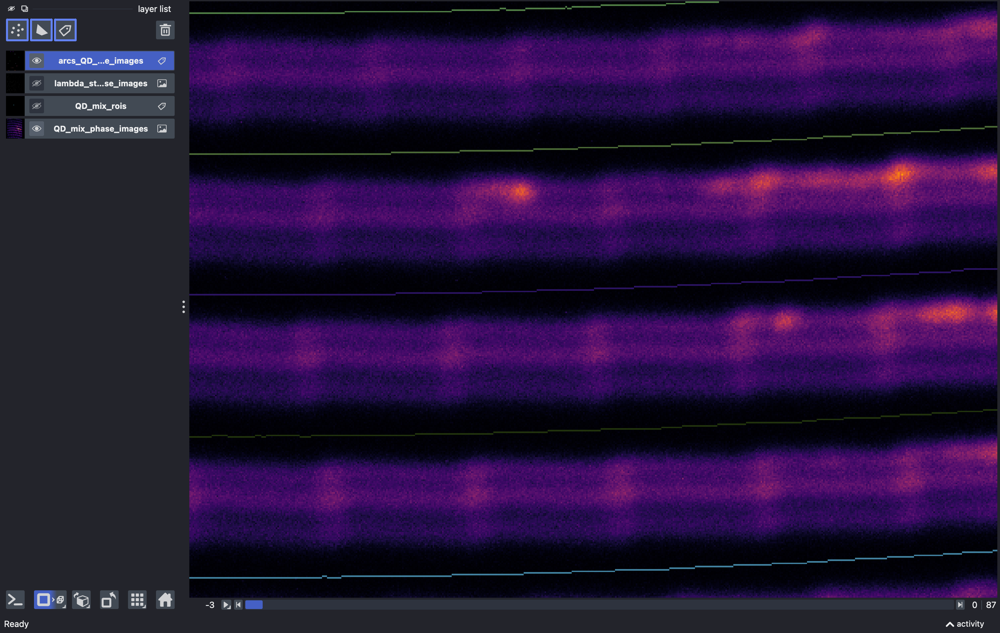

**Phase cost map** - one row per frame, folded phase cost; dark ridge = pattern line; bottom strip = one stripe per frame, as wide as the line.

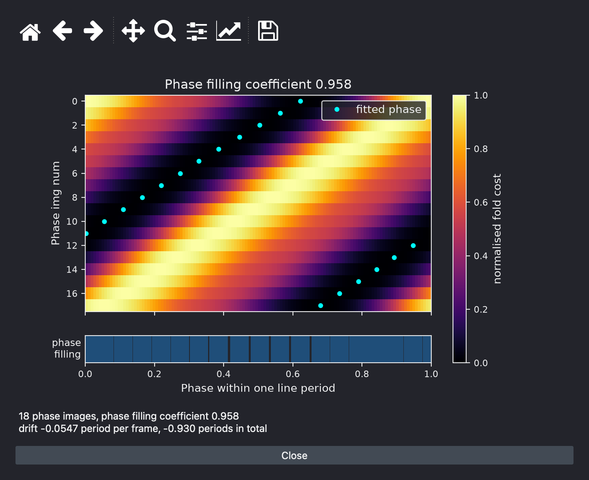

| Reading | Meaning | Action |
|---|---|---|
| all markers on one ridge | trajectory found | - |
| markers off the ridge | constraints too tight | raise `Phase slack`, lower `Step penalty` |
| gaps in the bottom strip | phase filling < 1, parts of every band never sampled | more frames, more drift between them, or check `Pattern passes` |

**Multithreading**

- With numba installed the reconstruction always runs multithreaded on all cores; without it, single-threaded on scipy.
- A napari notification at the start of every run states the mode and the number of threads.
- Kernels (`numba_kernels()`): template cost, phase fold, band sampling; compiled on the first run, cached on disk.
- Same algorithm as `PhaseModelRecon`; results are independent of the thread count but not bit-identical to the scipy path (summation order; the geometry refinement amplifies it).

| Path | `run()` on the sample, 12 cores |
|---|---|
| scipy | 30 s |
| numba | 4 s |

## Stack post-processing

| | |
|---|---|
| 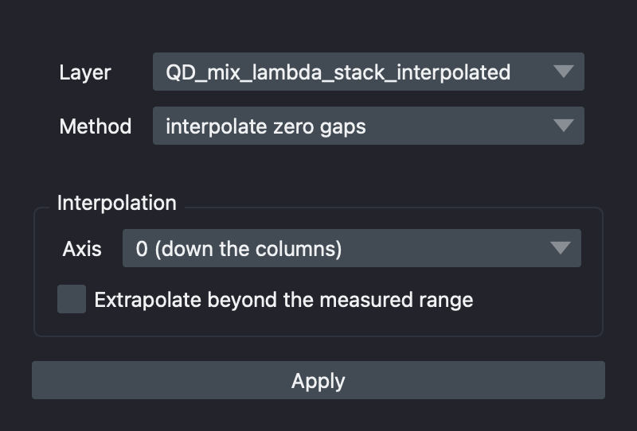 | 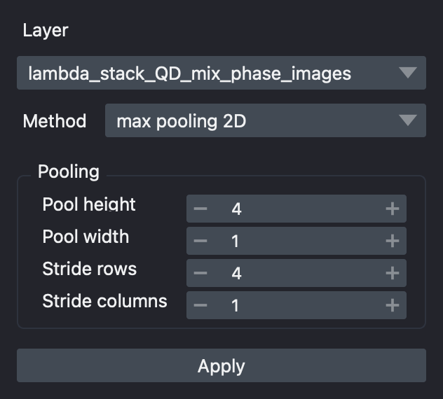 |

**interpolate zero gaps** - `interpolate_zero_gaps()`, zero pixels treated as missing.

| Parameter | Default | Values | Description |
|---|---|---|---|
| `Axis` | 0 | 0 (down the columns), 1 (along the rows) | 0 closes the horizontal gap stripes |
| `Extrapolate beyond the measured range` | off | on/off | extend edge values into outer gaps |

**max pooling 2D** - `max_pooling2d()`, display and screening only (biased upwards).

| Parameter | Default | Values | Description |
|---|---|---|---|
| `Pool height`, `Pool width` | 4, 1 | 1..128 | window |
| `Stride rows`, `Stride columns` | 4, 1 | 1..128 | step; output layer `scale` = stride |

- Output: `<layer>_interpolated` or `<layer>_pooled`.

## ROI spectra and calibration

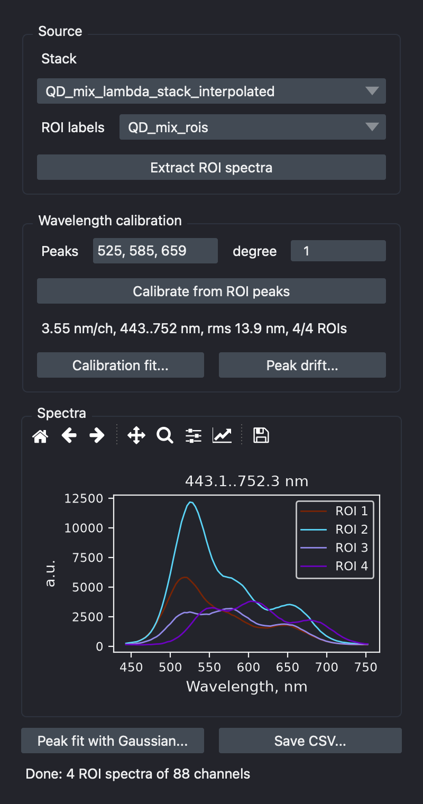

**1. Source**

| Parameter | Values | Description |
|---|---|---|
| `Stack` | 3D image layer | stack to measure |
| `ROI labels` | 2D or 3D labels layer | regions; a 3D layer is flattened and added as `<batch>_<name>_2D` |

**2. Wavelength calibration** - Gaussian peak fit of every ROI spectrum + `spectral_calibration()`.

| Parameter | Default | Values | Description |
|---|---|---|---|
| `Peaks` | 525, 585, 659 | comma-separated nm | known emission peaks |
| `degree` | 1 | 1..3 | polynomial degree, channel index -> wavelength |

- Only ROIs with exactly one fitted component per reference peak enter the fit.
- Result line: nm per channel, axis range, residual rms, ROIs used; its tooltip gives full precision and the excluded ROIs.
- After every calibration: `Start wavelength` = wavelength of channel 0, `Step` = (last - first) / (n - 1), put into the [Spectral axis](#spectral-axis) fields of the other widgets. A calibration running from long to short wavelengths is not passed on: reconstruct with `Invert the spectral axis`.
- **Calibration fit...** - reference peaks vs channel with the fitted polynomial; excluded ROIs listed in the legend (hollow marker) and in the report with the number of peaks found.

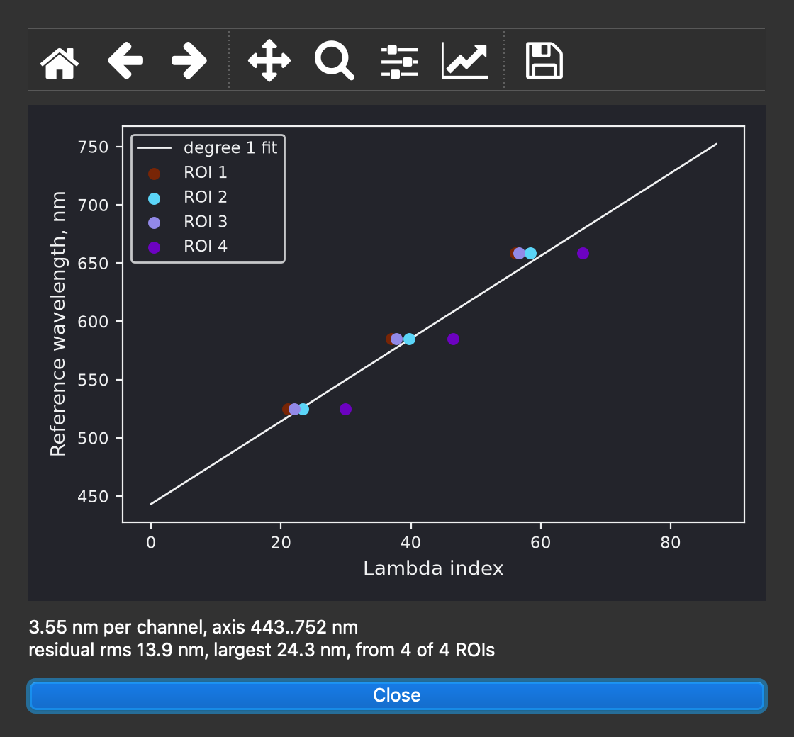

**Peak drift...** - tiles of the frame, emitters unmixed by Gaussian fit (`utils.peak_drift_unmixed()`), component positions along both frame axes.

> [!IMPORTANT]
> Valid for quantum dot calibration samples only (near-Gaussian emission). Unmixing, not peak-finding: the maximum of a mixture moves with the mixing ratio.

| Parameter | Default | Values | Description |
|---|---|---|---|
| `Tile size, px` | 64 | 8..512 | side of the square tile |
| `Min SNR` | 4.0 | 0..100 | noise sigmas a tile spectrum must clear |

| Slopes of the components (channels per 1000 px) | Diagnosis |
|---|---|
| equal | rigid tilt of the spectral axis |
| proportional to the channel index | mis-scaled axis |

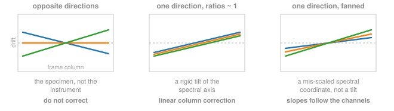

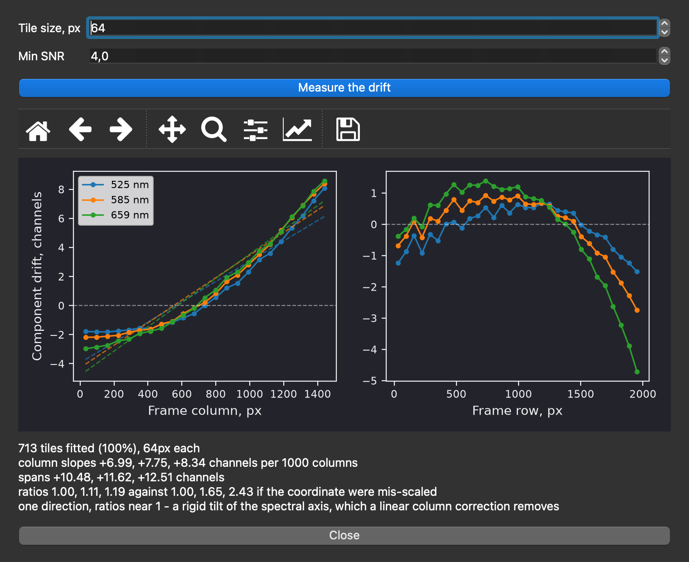

**3. Spectra** - plot in channels, in nm after calibration (title: calibrated range); curve colour = ROI label colour; takes the free height of the dock.

**Peak fit with Gaussian** - one region decomposed into components.

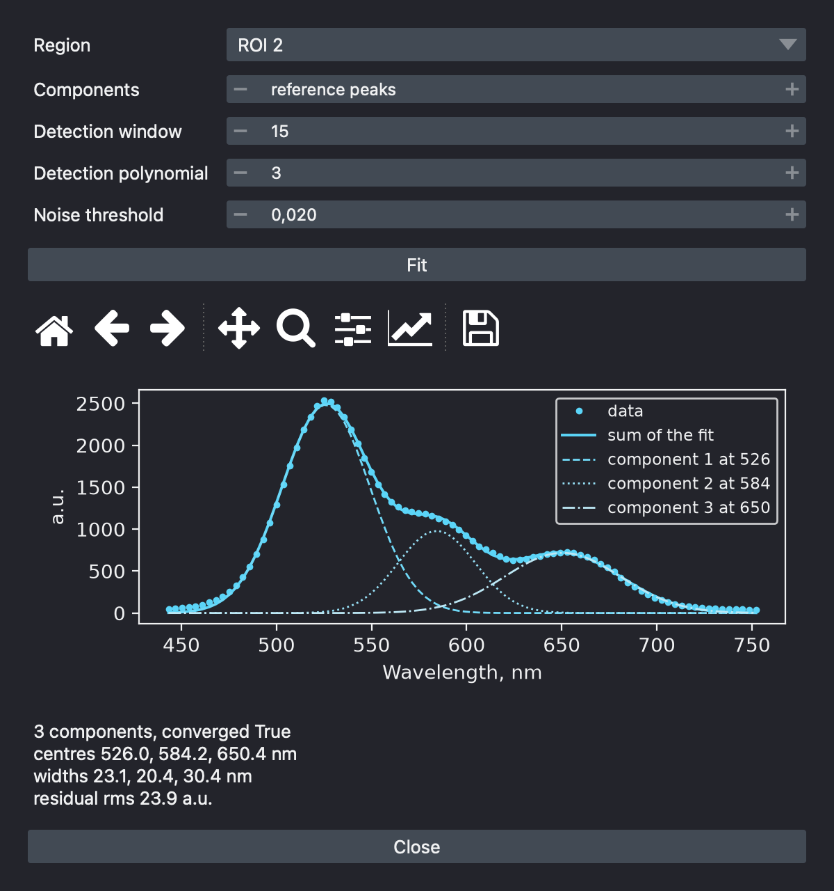

| Parameter | Default | Values | Description |
|---|---|---|---|
| `Region` | first | extracted ROIs | region to fit |
| `Components` | reference peaks | reference peaks, 1..20 | number of Gaussians |
| `Detection window` | 15 | 5..201, odd | Savitzky-Golay window, channels |
| `Detection polynomial` | 3 | 1..7 | Savitzky-Golay order |
| `Noise threshold` | 0.02 | 0..1 | rejected below this fraction of the maximum |

**4. Save CSV...** - one row per channel.

| Column | Format | Present |
|---|---|---|
| `lambda_index` | integer | always |
| `wavelength_nm` | one decimal | calibrated axis |
| `roi_<label>` | full precision | one per region |

```
lambda_index,wavelength_nm,roi_1,roi_2,roi_3,roi_4
0,443.3,42.7738,49.9025,34.9604,31.3488
```

## Spectral axis

Shared group of *Lambda stack to RGB*, *Stack to virtual channels* and *Adaptive dye separation*.

| Parameter | Default | Values | Description |
|---|---|---|---|
| `Start wavelength, nm` | 443.3 | 100..2000 | wavelength of channel 0 |
| `Step, nm per slice` | 3.51 | 0.0001..100 | channels run from short to long wavelengths |

| Source of the values | When |
|---|---|
| calibration | every calibration in *ROI spectra and calibration*, also into open widgets |
| manual | typed values; kept until the next calibration |
| default | calibration of the bundled sample |

- The line under the fields: channels, range in nm, source of the values (`calibration`, `manual`, `default`).

## Lambda stack to RGB

Spectrum of every pixel -> CIE 1931 2° XYZ -> sRGB. Use an interpolated stack: empty rows render black.

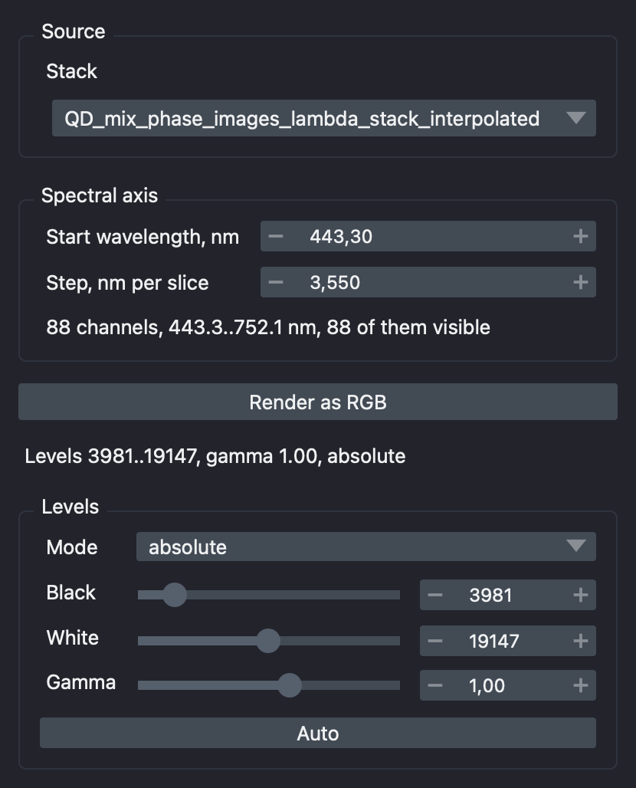

**Render as RGB** converts once; the **Levels** then act live on the kept colour.

| Level | Default | Values | Description |
|---|---|---|---|
| `Mode` | absolute | absolute, per-pixel | see below |
| `Black` | auto | 0..max brightness (slider), any (box) | brightness rendered black |
| `White` | auto | as `Black` | brightness rendered white; absolute only |
| `Gamma` | 1.0 | 0.1..5, log slider | 1 = linear; < 1 lifts faint regions; absolute only |
| `Auto` | - | - | black = median brightness, white = 99.5th percentile |

| Mode | Brightness | Use |
|---|---|---|
| absolute | black -> white -> gamma | appearance; with black 0, gamma 1 relative brightness is exact |
| per-pixel | full for every pixel above `Black`, 0 below | colour only |

- Brightness = brightest display channel of a pixel, in stack units (flat spectrum of intensity `v` -> `v`).
- Levels scale the three channels of a pixel together: hue is kept. napari's own contrast limits on the RGB layer act per channel and shift the hue - keep them at 0..255.
- The automatic black (median) suits sparse emitters on a background; lower it for a specimen filling the frame.

| Colorimetry step | Method |
|---|---|
| spectral weighting | CIE 1931 2° CMF (`cie1931_2deg.csv`, CVRL, 360..830 nm, 1 nm) interpolated onto the axis; channels outside 360..830 nm carry no weight |
| white | equal-energy -> D65, Bradford |
| to sRGB | IEC 61966-2-1 matrix |
| out of gamut | desaturated towards white at constant hue |
| highlights | pixel scaled as a whole, no per-channel clipping |
| transfer curve | sRGB gamma |

- 2° observer fixed: sRGB is defined on it.

| Output | Type | Shape |
|---|---|---|
| `<batch>_rgb` | image, rgb, uint8 | `(H, W, 3)` |

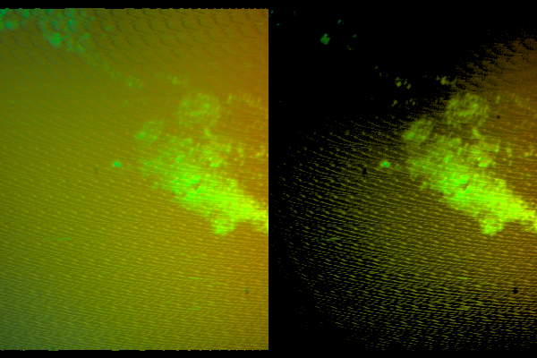

*Absolute mode, black 0 (left) and automatic levels (right).*

## Stack to virtual channels

`virtual_channels()`: channel `k` = per-pixel sum of the input channels whose wavelength lies in range `k`, bounds included.

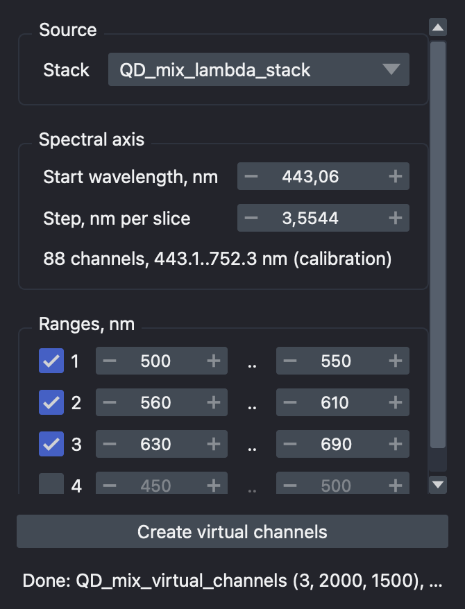

| Parameter | Default | Values | Description |
|---|---|---|---|
| `Stack` | - | 3D image layer | spectral first axis |
| `Start wavelength, nm`, `Step, nm per slice` | calibration | see [Spectral axis](#spectral-axis) | |
| Range 1..4 | 500..550, 560..610, 630..690 on; 450..500 off | 100..2000 nm, 1..4 enabled | pass bands; every enabled range must hold a channel |

| Output | Type | Shape |
|---|---|---|
| `<batch>_virtual_channels` | image, float32 | `(n_ranges, H, W)` |

- Sums are exact for integer stacks up to 2^24 per pixel.
- XY scale and offset of the source are kept.

## Adaptive dye separation

`adaptive_dye_separation()`: blind separation after the Leica TCS SP2 manual (pp. 221-224). Dye spectra are found in the stack; no reference spectra are needed.

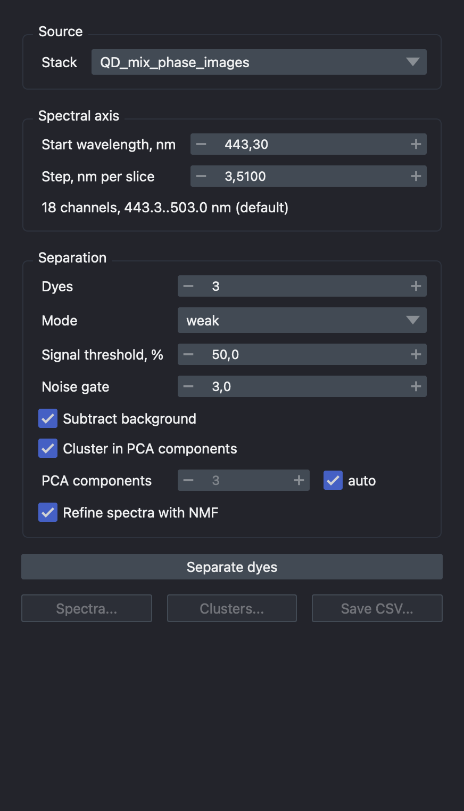

| Parameter | Default | Values | Description |
|---|---|---|---|
| `Stack` | - | 3D image layer | spectral first axis |
| `Start wavelength, nm`, `Step, nm per slice` | calibration | see [Spectral axis](#spectral-axis) | axis of the spectra and the CSV; no effect on the separation |
| `Dyes` | 3 | 2..8, below the channel count | number of dyes |
| `Mode` | weak | weak, strong | reference point of a cluster: its side away from the other clusters, or its centre |
| `Signal threshold, %` | 50 | 0..99 | percentile of the pixels above the noise gate under which they are left out of the clustering |
| `Noise gate` | 3.0 | 0..20 | noise levels a pixel must exceed to enter the clustering; 0 = off |
| `Subtract background` | on | on/off | median spectrum of the darkest 5% of the pixels |
| `Cluster in PCA components` | on | on/off | uncentred PCA before the clustering |
| `PCA components` | auto | `Dyes`..20 | components kept; the box holds the count of the last run |
| `auto` (next to `PCA components`) | on | on/off | components whose energy exceeds 20 noise floors, at least `Dyes`; off - exactly the number in the box |
| `Refine spectra with NMF` | on | on/off | non-negative factorisation starting from the reference points |

| Step | Method |
|---|---|
| 1. sample | up to 200 000 pixels, fixed seed; pixels zero in every channel are skipped and stay 0 |
| 2. noise | part of a pixel outside the leading components |
| 3. cluster | spherical k-means of the pixels above both thresholds |
| 4. spectra | reference point of every cluster, then NMF |
| 5. separate | pseudo-inverse of the spectra applied to the stack, negative values clipped at 0 |

| Output | Type | Shape |
|---|---|---|
| `<batch>_ads` | image, float32 | `(dyes, H, W)`; dye signal in stack units, summed over the channels; dyes ordered by peak channel |
| `<batch>_ads_clusters` | labels, uint8, hidden | `(H, W)`; strongest dye, 0 = below the noise gate or empty |

**Spectra...** - dye spectra in nm, energy per principal component; components above the flat noise floor = dyes the stack appears to hold.

**Clusters...** - the sampled pixels in the feature space.

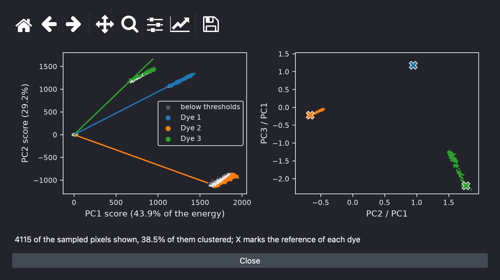

| Panel | Axes | Shows |
|---|---|---|
| left | PC1, PC2 scores | pixels coloured by dye, grey below the thresholds; a line from the origin along every reference spectrum |
| right | PC2 / PC1, PC3 / PC1 | pixel directions, the space the clustering separates; X = reference of each dye |

- Components of the uncentred PCA, also when `Cluster in PCA components` is off.
- Up to about 4000 pixels, evenly spaced through the sample.

**Save CSV...** - one row per channel: `lambda_index`, `wavelength_nm`, `dye_<k>`.

| Warning | Limit | Check |
|---|---|---|
| Unstable | spectra from two halves of the pixels differ by > 5° | signal too weak, or thresholds too high |
| Negative energy | > 10% of the energy | no empty pixels for the background, or wrong `Dyes` |
| Two spectra coincide | < 5° apart | too many `Dyes` |

> [!IMPORTANT]
> One fixed spectrum per dye across the frame is assumed. Pixels that hold no pure dye, or spectra that shift across the frame, distort the result without a warning: compare the energy curve with `Dyes` and the spectra with the expected emission.

- No warning does not prove the separation is correct.
- Reconstruct with `Accumulation` = mean: `max` is not linear in the intensity.
- XY scale and offset of the source are kept.

# Setup calibration

Order of measurements on a new microscope; each result goes into [setup_params.yaml](#setup-parameters).

| Step | Sample | Measure | Key | Check |
|---|---|---|---|---|
| 1. Disk pattern | - | simulate the disk in the field of view with `disk_simulation.ipynb` of `spectra-spin`; save the image | `disk.pattern_file`, `disk.pattern_rotate_180` | modelled arcs (`<batch>_arcs`) lie on the lines of every frame |
| 2. Channels | any series, `Lambda channels` auto | rounded median line period in rows, from the run log | `optics.n_lambda` | the same count from series to series |
| 3. Drift direction | any series | sign of the fitted drift (phase cost map report) | `disk.drift_direction` | the same sign in every series |
| 4. Pass width | uniform fluorescent plate, 1 pass, known pulse shift between frames | `pass_width = abs(drift per frame, periods) × pass_pulse_us / pulse shift per frame, µs` | `disk.pass_width`, `disk.pass_pulse_us` | series with 2 and 4 passes: drift scales with the shift, `phase_filling` ≈ 1, no gaps or overlaps in the phase cost map strip |
| 5. Dispersion direction | sample with known emission peaks | do the channels run from short to long wavelengths? | `optics.invert_spectral_axis` | [Spectral calibration](#spectral-calibration) gives a positive step |
| 6. Spectral resolution | narrow line at 1 pass: plate behind a 1..10 nm band-pass filter, laser reflection or spectral lamp | FWHM of the line in channels | `optics.spectral_fwhm` | the same line at 2 and 4 passes matches `Spectral resolution` |

- Step 2 on the reference setup: the period is 88.4..88.6 rows, so auto gives 88 or 89 by series; the fixed count keeps channels comparable. It also scales `Init sigma`, `Fold sigma`, `Arc edge tolerance`.
- Step 4 on the reference setup: 150 µs shift, drift 0.0997 period per frame → `pass_width` 0.0532; the line moves 4.72 rows per 80 µs pulse in an 88.5-row period.
- A pass width from `disk_simulation.ipynb` is half the measured one on the reference setup (its disk speed is half the real one): measure, do not simulate.
- `Pattern passes` = pulse / `disk.pass_pulse_us`; a fractional value means the pulse does not fit the pass width.
- Step 6 on the reference setup: not measured yet; 11 channels is an estimate, see `docs/spectral_calibration.md`.
- Widget settings, not keys of the file, if the fit does not lock on a new setup: widen `Grid scale`, `Grid shift`, `Grid rotation`; raise `Family degree` if arcs leave the lines at the frame edges; despeckle and dark level per camera in *Preprocess every frame*.

# Spectral calibration

Wavelength axis of a lambda stack; repeated per sample and per acquisition setting, not stored in `setup_params.yaml`.

| Step | Widget | Action |
|---|---|---|
| 1. Reconstruct | *Phase model reconstruction* | the `Pattern passes` of the acquisition; `Invert the spectral axis` per `optics.invert_spectral_axis` |
| 2. Regions | napari labels layer | one region per area with all reference emitters |
| 3. Fit | *ROI spectra and calibration* | `Peaks` = known emission maxima of the standard (default QD 525, 585, 659 nm), `degree` 1 |
| 4. Check | `Calibration fit...` | residual rms small against the step (0.17 nm on the reference QD data); excluded regions listed |
| 5. Spread | automatic | `Start wavelength`, `Step` go to the [Spectral axis](#spectral-axis) of the other widgets |

| Effect | Rule |
|---|---|
| Channel = fraction of a band | the axis depends on the band geometry, not on the crop; recalibrate after any change of disk, prism, camera or magnification |
| Peak drift across the frame | check with `Peak drift...` before trusting one axis for the whole field |
| Wide lines | spectra blur with `Pattern passes`: negligible up to 3 passes, noticeable at 4, strong at 5..6 |
| Line centre | the fitted phase follows the centre of a wide line within 0.8 rows; calibrate on a series with the same `Pattern passes` as the measurement |
| Reference spectra for unmixing | taken at the same `Pattern passes` as the measurement, or blurred to it |
| Calibration running from long to short wavelengths | not passed on to other widgets; reconstruct with `Invert the spectral axis` |
